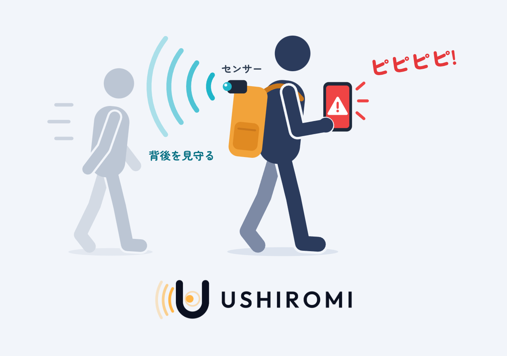

# USHIROMI: 夜道の背後を見守る、第三の目

  

## 製品概要

### 背景(製品開発のきっかけ、課題等）
開発の息抜きに、よく散歩やジョギングをしています。家の周りは車通りが多いので、コースにはサイクリングロードを選んでいます。

ただ、この道は非常に暗く、背後に誰かいる気配がしたり、後ろから急に掴まれたらどうしようと不安になったりして、つい何度も後ろを振り返ってしまいます。

そこで、自分では見えない背後を常に見張り、近づいてくる人などの危険を検知して知らせてくれるプロダクトがあればいいなと思い、USHIROMI を作りました。

家の近くにある暗い夜道の例（画像をクリックすると YouTube で再生します）：

  

### デモ動画
スマホに自分の背後がこのように映り、近づいてくる人がいると**音**で警告してくれます。

### 夜道をテーマにした他のアプリとの違い
夜道をテーマにしたアプリやサービスは、ほかにもあります。たとえば、JPHACKS 2022 で審査委員特別賞を受賞した[「安心夜道」](https://github.com/jphacks/B_2220)です。

こうした既存のアプリやサービスの機能は、大きく 2 つに分けられます。

- **危険を起こりにくくする**：電話をしているふりをする（フェイク電話）など
- **危険が起きたときに対処する**：1 タップで防犯ブザーを鳴らす、家族や警察に緊急通報する など

一方で、**危険が迫っていることを検知する**機能はありませんでした。

USHIROMI は、この「検知」を担います。緊急地震速報で揺れが来る前に身構えられるように、背後から人が近づいてきた時点で知らせるので、危険が起きる前に対応できます。
逃げられるかもしれない。防犯ブザーを鳴らしたり、緊急通報したりする余裕ができるかもしれない。

これまでになかったこの「検知」があれば、既存の防犯ブザーや緊急通報もより確実に使えるようになります。
そしてなにより、夜道を一人で歩く人にとって、「背後を見てくれている」という安心感は大きな支えになるはずです。

### 製品説明（具体的な製品の説明）

  

リュックなどに、背後向きの ToF センサー（Arducam ToF B0410）と Raspberry Pi 4 を固定して使います。
スマホをつなぐと、スマホで背後の様子を見られ、近づいてくる人がいると警告音が鳴ります。

仕組みは次のとおりです。

1. ToF センサーで背後までの距離を測る
2. YOLOX-Nano で人を見つける
3. 見つけた人を追跡し、近づく速さを求める
4. 近づいてくる人がいると、2〜3 m 手前で画面が赤くなり、警告音が鳴る

### 特長
#### 1. カメラ映像を使わない
暗い夜道では、カメラにはほとんど何も映りません。
そこで、自ら光を出して距離を測る ToF センサーで人を見つけます。暗闇でも動き、通行人の顔も映りません。

#### 2. 近づいてくる人だけを知らせる
後ろにいる人を一人ひとり追いかけ、近づく速さを見て、近づいてくる人がいるときだけ知らせます。
ゆっくり近づく人にも、遠くから走ってくる人にも気づけます。

#### 3. 背後を 3D で見られる
自分を中心にした 3D の点群で、何 m 後ろに人がいるかがひと目で分かります。

### 解決出来ること
- 死角になる背後から、気づかないうちに迫られることがなくなる
- 画面を見続けていなくても、人の接近を音で知れる
- 家族や友人がスマホで見守れる

### 今後の展望
緊急地震速報と同じく、身の危険に直結するプロダクトです。検知の精度と速度が上がるほど、警告を早く出せます。
そこで、機械学習の精度と速度を限界まで高めていきます。

生成 AI で誰でもなんでも作れる時代だからこそ、普通の人が AI を使っても真似できないレベルの技術力を見せたいと考えています。

### 注力したこと（こだわり等）
- Raspberry Pi 4 だけで、検知・追跡・表示・警告までを 30 fps で動かした
- 検知が一瞬途切れても追跡が途切れないよう、カルマンフィルタを用いた
- 「ハードウェア × 機械学習」という、挑戦してみたかった技術の組み合わせに取り組んだ

## 開発技術
### 活用した技術
#### API・データ
- Arducam ToF カメラ SDK
- WebSocket（Pi → ブラウザ）

#### フレームワーク・ライブラリ・モジュール
- YOLOX-Nano、ONNX Runtime（人の検出）
- NumPy、aiohttp（Pi）
- React、TypeScript、Vite、three.js（画面と 3D 表示）

#### デバイス
- Arducam ToF B0410
- Raspberry Pi 4
- PC・スマホ（ブラウザ）

### 独自技術
#### ハッカソンで開発した独自機能・技術
- **人の検出の高速化**：YOLOX-Nano の解像度を、精度と速度のバランスを見ながら調整した
  - [scripts/export_yolox_onnx.py](scripts/export_yolox_onnx.py)、[pi/detect.py](pi/detect.py)
- **カルマンフィルタによる追跡**：人までの距離を予測して、検出が途切れても同じ人として追い続ける
  - [pi/track.py](pi/track.py)
- **3D の点群と、人を囲む円柱**：背後を 3D の点群で表示し、人を円柱で囲む。ノイズを取り、点を間引いて、見やすく軽くした
  - [web/src/cloud.ts](web/src/cloud.ts)、[web/src/components/PointCloudView.tsx](web/src/components/PointCloudView.tsx)
