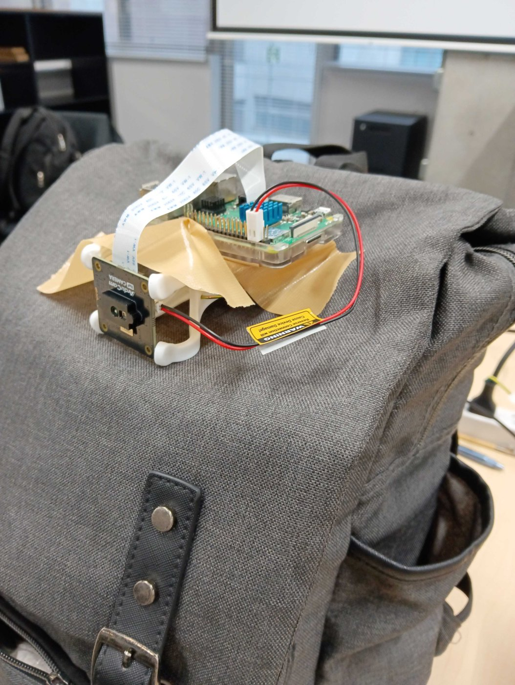

# USHIROMI: 夜道の背後を見守る、第三の目

  

## 製品概要

### 背景(製品開発のきっかけ、課題等）
暗い夜道を一人で歩くのは怖いものです。JPHACKS 2022 で審査委員特別賞を受賞した[「安心夜道」](https://github.com/jphacks/B_2220)でもテーマになっているように、多くの人が同じ不安を抱えています。
背後に人の気配を感じて、何度も振り返ってしまった経験は誰にでもあるはずです。しかし背後は死角なので、すぐ後ろまで迫られてから気づいたのでは、逃げる時間がありません。

この不安は、歩いている本人だけのものではありません。友人や家族の帰りが遅いとき、待っている側も「無事に帰れるかな」と心配になります。

何かが起きたあとの安心は、「安心夜道」のような既存のアプリやサービスがすでに支えています。一方で、**何かが起きる前に気づいて備える**ことは、既存のサービスではできていません。私たちはそこに着目しました。

「何かが起きても大丈夫」から、「何かをそもそも起こさせない」へ。
USHIROMI は、夜道を歩く本人と、帰りを待つ人の両方の「安心・安全」を守ります。

### 製品説明（具体的な製品の説明）

  

リュックの上に、背後向きの ToF センサー（Arducam ToF B0410）と Raspberry Pi 4 を固定して使います。

1. センサーで背後の距離を測る
2. YOLOX-Nano で人を見つける
3. 人を追跡して、近づく速さを出す
4. 近づいてくる人がいると、2〜3m 手前で画面が赤くなり、警告音が鳴る

画面は、背後を 3D の点群で表示し、人を円柱で囲みます。
Pi が Web サーバーを兼ねるので、PC やスマホのブラウザで開くだけで使えます。**スマホでも使えるので、歩きながら背後を確かめられます。**

### 特長
#### 1. カメラ映像を使わない
暗い夜道では、カメラにはほとんど何も映りません。
そこで、自分で光を出して距離を測る ToF センサーで人を見つけます。暗闇でも動き、通行人の顔も映りません。

#### 2. 距離画像で人を見つけて追跡する
Raspberry Pi で動く軽いモデル（YOLOX-Nano）で人を見つけ、追跡します。
近づく速さから、ゆっくり近づく人も、走ってくる人も知らせます。

#### 3. 背後を 3D で見られる
自分を中心にした 3D の点群で、何 m 後ろに人がいるかがひと目で分かります。

#### 4. 帰りを待つ家族や友人も安心できる
リンクを共有すると、家族や友人も自分のスマホから同じ画面を見られます（今は同じ Wi-Fi の中だけ）。

### 解決出来ること
- 死角になる背後から、気づかないうちに人が迫ることを防ぐ
- 画面を見続けなくても、接近を音と色で知る
- 家族や友人がスマホで見守れる

### 今後の展望
- **ネット越しの見守り**：離れた家族や友人も見られるようにする
- **画面を見なくても気づける**：イヤホンや左右の音で知らせる
- **ついてくる人に気づく**：ずっと同じ距離でついてくる人を知らせる
- **小さく、身につけやすく**：小さなケースにまとめる
- **遠くの人も早く見つける**：今は 2〜3m 手前。もっと早く知らせる

### 注力したこと（こだわり等）
* Raspberry Pi 4 だけで、表示と警告を 30fps で動かす
* 腕を一瞬振っただけでは鳴らない。鳴り始めは小さな音から
* 暗い所でも見やすい画面

## 開発技術
### 活用した技術
#### API・データ
* Arducam ToF カメラ SDK
* WebSocket（Pi → ブラウザ）

#### フレームワーク・ライブラリ・モジュール
* YOLOX-Nano、ONNX Runtime（人の検出）
* NumPy、aiohttp（Pi）
* React、TypeScript、Vite、three.js（画面と 3D 表示）

#### デバイス
* Arducam ToF B0410
* Raspberry Pi 4
* PC・スマホ（ブラウザ）

### 独自技術
#### ハッカソンで開発した独自機能・技術
* **人の検出の高速化**：YOLOX-Nano を、センサーに合わせた 256×192 で書き出し直し、精度はそのままに約 3 倍速くした
  * [scripts/export_yolox_onnx.py](scripts/export_yolox_onnx.py)、[pi/detect.py](pi/detect.py)
* **カルマンフィルタによる追跡**：人までの距離を予測して、検出が途切れても同じ人として追い続ける
  * [pi/track.py](pi/track.py)
* **3D の点群と、人を囲む円柱**：背後を 3D の点群で表示し、人を円柱で囲む。ノイズを取り、点を間引いて、見やすく軽くした
  * [web/src/cloud.ts](web/src/cloud.ts)、[web/src/components/PointCloudView.tsx](web/src/components/PointCloudView.tsx)
